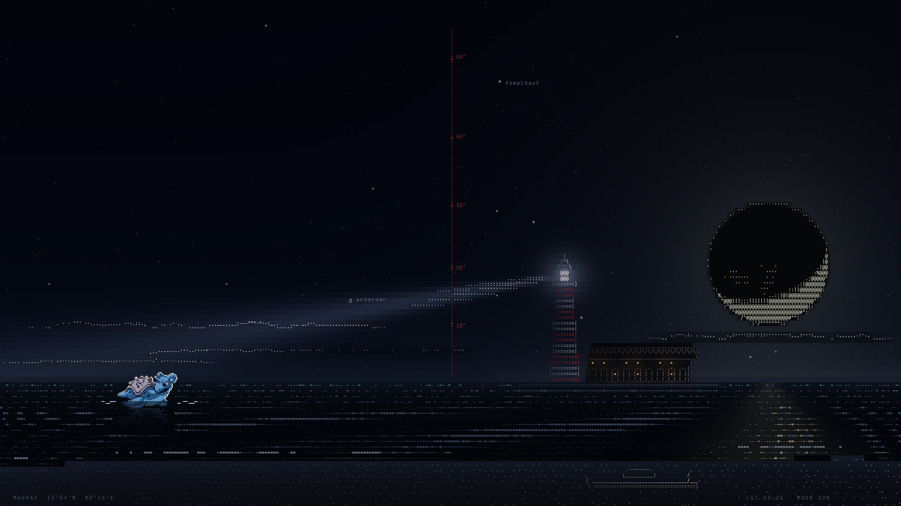

<div align="center">



# dotfiles

**An i3 desktop with its own Rust shell, four colour worlds, an e-ink mood, live math wallpapers and a 10 ms file search.**


[Install](#install) · [Keys](#everyday-keys) · [loka shell](#loka--the-shell) · [Worlds and moods](#worlds-and-moods) · [Wallpapers](#wallpapers) · [evry](#evry--file-search) · [Layout](#repository-layout) · [Cost](#what-it-costs)

</div>

---

## Highlights

| | |
|---|---|
| **loka** | One Rust binary is the bar, the dynamic island, the control centre, the notification daemon, the tray host and the clipboard history. About 20 MB of RAM, under 1% CPU at idle. |
| **Worlds** | Meridian, Katha, Sakuga and Toon. Each world brings its own hues to every program at once. Sakuga reads its accents from the wallpaper. |
| **Paper mood** | An e-ink look: the wallpaper reprinted in 16 grey levels, and every window passed through a GPU shader with ordered dither, ink spread and paper fibre. |
| **mathwall** | Live wallpapers drawn by the GPU: a temple town at dusk, chaotic attractors, Chladni plates. 1 to 4.5 ms per frame, and asleep whenever a window is open. |
| **evry** | Every file on the disk, searched as you type. 865 000 entries indexed in 2.7 s, about 10 ms per query, no daemon. |
| **One palette** | Built in OKLCH with fixed contrast targets, rendered into i3, ghostty, fish, Neovim, rofi, GTK, zathura, btop, cava, Thorium and limusic. |

## Install

```sh
git clone <this repo> ~/dotfiles && cd ~/dotfiles
./install.sh --dry-run all                          # print what would happen
./install.sh packages link build extras theme user  # the desktop
./install.sh system                                 # optional: SDDM login theme
```

Each step is idempotent. `link` moves any clashing file to `.backup/<date>/` first. To undo a package: `stow -D -t ~ <pkg>`.

<details>
<summary><b>What each step does</b></summary>

| Step | Does |
|---|---|
| `packages` | apt packages for the i3 desktop, pywal16 through uv (sudo) |
| `link` | backs up clashing files, stows every package into `~`, links `loka/bin/*` into `~/.local/bin` |
| `build` | evry, mochi, mathwall, limusic `rice.so`, the loka shell, Neovim language servers and plugins |
| `extras` | Pokémon terminal sprites, a first set of mathematical wallpapers |
| `theme` | generates every colour file from the current wallpaper |
| `user` | default apps, the evry index timer, lock hooks, Thorium flags |
| `system` | SDDM with the Dog Samurai theme (sudo) |

Not in apt: JetBrainsMono Nerd Font, ghostty, Thorium, the limusic AppImage, cargo (rustup.rs), typst, the catppuccin cursor.

</details>

## Everyday keys

| Key | Action |
|---|---|
| <kbd>Super</kbd> <kbd>Space</kbd> | Launcher: **Apps** (no match searches the web). <kbd>Ctrl</kbd> <kbd>Tab</kbd> moves to Files, Web, Calc, Windows, Keys and keeps what you typed |
| <kbd>Super</kbd> <kbd>O</kbd> | **Files**: every file on the disk, as you type |
| <kbd>Super</kbd> <kbd>D</kbd> | **Documents**: PDFs, newest first, open in zathura |
| <kbd>Super</kbd> <kbd>U</kbd> | **Web**: bookmarks of every browser profile, or open and search |
| <kbd>Super</kbd> <kbd>=</kbd> | **Calc**: qalc answers while you type, <kbd>Enter</kbd> copies. `=2^10` works in every tab |
| <kbd>Super</kbd> <kbd>X</kbd> | Control centre. <kbd>Super</kbd> <kbd>Shift</kbd> <kbd>N</kbd> notifications · <kbd>Super</kbd> <kbd>Y</kbd> calendar · <kbd>Super</kbd> <kbd>,</kbd> settings · <kbd>Super</kbd> <kbd>Shift</kbd> <kbd>D</kbd> do not disturb |
| <kbd>Super</kbd> <kbd>C</kbd> | Clipboard history (text and images). <kbd>Super</kbd> <kbd>`</kbd> drop-down terminal |
| <kbd>Super</kbd> <kbd>T</kbd> | World switcher: wallpaper cards per world (<kbd>←</kbd><kbd>→</kbd> wallpaper, <kbd>↑</kbd><kbd>↓</kbd> world). <kbd>Super</kbd> <kbd>Shift</kbd> <kbd>T</kbd> next world |
| <kbd>Super</kbd> <kbd>Ctrl</kbd> <kbd>D</kbd> | Live wallpaper moves or holds still. <kbd>Super</kbd> <kbd>Ctrl</kbd> <kbd>N</kbd> next scene · <kbd>Super</kbd> <kbd>Ctrl</kbd> <kbd>A</kbd> new math wallpaper |
| <kbd>Super</kbd> <kbd>Shift</kbd> <kbd>S</kbd> | Screenshot: drag an area or click a window. <kbd>Super</kbd> <kbd>Ctrl</kbd> <kbd>S</kbd> capture menu · <kbd>Super</kbd> <kbd>Ctrl</kbd> <kbd>R</kbd> record |
| <kbd>Super</kbd> <kbd>M</kbd> | limusic (YouTube Music). <kbd>Super</kbd> <kbd>F8</kbd> <kbd>F9</kbd> <kbd>F10</kbd> previous, play, next |
| <kbd>Super</kbd> <kbd>Z</kbd> | WhatsApp (ZapFast). <kbd>Super</kbd> <kbd>.</kbd> kaomoji · <kbd>Super</kbd> <kbd>N</kbd> the desktop cat |
| <kbd>Super</kbd> <kbd>/</kbd> | **Every key and command**, searchable |

The key list is built from the `## text` lines in the i3 config and `rice/.local/share/rice/keys.tsv`. Printed sheets: [`docs/i3-survival.txt`](docs/i3-survival.txt), [`docs/nvim.md`](docs/nvim.md), [`docs/fish.md`](docs/fish.md).

## loka · the shell

`loka/shell/` builds one binary, `~/.local/bin/loka`. It draws straight into X11 shared memory with tiny-skia, talks to i3, PipeWire, UPower, NetworkManager, BlueZ, logind, MPRIS and power-profiles-daemon directly, and owns `org.freedesktop.Notifications` and the StatusNotifier watcher.

```
bar ──── workspaces · focused window · stats · tray · Wi-Fi · Bluetooth · volume · battery · power
island ─ clock · toasts · volume / brightness OSD · now playing · hides itself over fullscreen
pages ── Wi-Fi · Bluetooth · audio mixer · battery history · recording · calendar
         notifications · clipboard · settings · power
```

- Every page works from the keyboard: <kbd>Tab</kbd> and arrows move, <kbd>Enter</kbd> acts, <kbd>Esc</kbd> goes back.
- Commands: `loka-key NAME` or `loka msg NAME`, where NAME is one of `controls wifi bluetooth audio battery record recordToggle calendar notifications clipboard settings powermenu worlds worldNext dnd close`.
- Start: `autostart.sh` starts `loka` when `~/.config/loka/shell-on` exists. Without that file, polybar, dunst and xfce4-clipman run as a spare.
- Wi-Fi (`wifi.rs`, one `nmcli` call per list) and clipboard history (`clip.rs`, on xclip) are native. Screen recording and the captive-portal check are small scripts in `loka/scripts/`.
- Build: `cargo build --release` in `loka/shell/`, then `install -m755 target/release/loka ~/.local/bin/`.
- Test without touching the desktop: `loka/dev/run.sh` opens a nested i3 in Xephyr on `:7`.

## Worlds and moods

One palette drives everything. `theme/apply.py` turns the world's hues into an OKLCH palette with fixed lightness and contrast targets, then renders every file in `theme/templates/` into `~/.config`.

| World | Character |
|---|---|
| **Meridian** | near-monochrome slate with one red accent; the default |
| **Katha** | deep indigo, gold and rose |
| **Sakuga** | accents read from the wallpaper (pywal16 hues only; lightness and contrast stay fixed) |
| **Toon** | plum, sunflower yellow and mint |

| Mood | Look |
|---|---|
| **night** | the world's own theme |
| **paper** | e-ink: neutral paper and ink, the wallpaper reprinted in 16 grey levels, and every window through [`paper.glsl`](picom/.config/picom/shaders/paper.glsl) (16 levels, ordered dither, ink spread, paper fibre). The bar, island and wallpaper stay out of the shader |

`rice world NAME [FILE]` changes the world, `rice mode night|paper|next` the mood. A change reaches open windows at once: loka, i3, ghostty, fish, Neovim (colorscheme `rice`), zathura, GTK apps, cava, the live wallpaper and the browser's next new tab.

> [!IMPORTANT]
> Never edit generated files (`colors.*`, `starship.toml`, `gtk.css`, `nvim/colors/rice.lua` …). Edit `theme/templates/*` and run `rice`.

## Wallpapers

Two kinds, one switcher. <kbd>Super</kbd> <kbd>T</kbd> shows the current world's pictures and videos as cards; `rice pick` shows live scenes and pictures in one rofi grid.

- **Pictures**: put them in `wallpaper/WORLD/` or `~/Pictures/wallpapers`. `rice wall PATH|next|prev|random`.
- **Live scenes**: one `.frag` file each in `rice/.local/share/mathwall/scenes/` (a new file is a new wallpaper), plus the built-ins of `mathwall/`. `rice scene NAME|next|none`, `rice live on|off|always|toggle`. A scene moves only while the workspace is empty, on mains, with the screen on.
- **Switching**: the new look opens as a soft circle from the island (0.9 s, drawn by mathwall under the windows).

| Scene | What it draws |
|---|---|
| `temple` | a temple town across its tank: a seven-storey gopuram, palms, hills, all mirrored in the water; dusk with oil lamps or dawn with mist and birds |
| `aizawa` `lorenz` `thomas` `halvorsen` `dadras` | one orbit of a chaotic system as a 240 000-vertex line, slowly turning, pulses running along it |
| `harmonograph` `phyllotaxis` | a pendulum figure that keeps retuning itself; a sunflower spiral breathing around the golden angle |
| `chladni` | sand figures on a vibrating plate whose modes drift |

GPU cost at 1080p (`mathwall --bench 60 --scene NAME`): 1 to 3 ms per frame for the mathematical scenes, about 4.5 ms for `temple`, at 30 fps.

## evry · file search

`evry index` walks the disk (about 865 000 entries in 2.7 s) into one flat file. Each query memory-maps it and runs a SIMD substring scan over every name: about 10 ms, no daemon, nothing kept in RAM. A systemd user timer refreshes the index every 20 minutes at idle priority.

| Query | Means |
|---|---|
| `thesis pdf` | all words match, at least one in the file name. A capital letter makes a word case-sensitive |
| `notes/` `docs/intro` | anything inside a folder named like that |
| `pdf: doc: img: vid: audio: code: zip: dir: file: home: sys: ext:rs *.png` | filters; without a plain word, newest first |

Ranking: name matches beat path matches, your files beat system files and caches, recent and often-opened files rise. In the launcher: <kbd>Enter</kbd> open, <kbd>Shift</kbd> <kbd>Enter</kbd> show in folder, <kbd>Ctrl</kbd> <kbd>Y</kbd> copy path, <kbd>Ctrl</kbd> <kbd>T</kbd> terminal there, <kbd>Ctrl</kbd> <kbd>O</kbd> edit in Neovim. In a terminal: `evry WORDS`, or `ev` in fish for a live fzf search with preview. Settings: `~/.config/evry/config`.

`evry/rofi/` builds the rofi modes: `files.so` and `calc.so` (live tabs that replace the list as the helper answers), `search.so` (the web-search row: `yt gh w te aw pkg maps tr mal dex ai`) and `mouseup` (rofi waits until no mouse button is held).

## More pieces

<details>
<summary><b>Music · limusic</b></summary>

<kbd>Super</kbd> <kbd>M</kbd> shows or hides limusic, started on first use. `limusic/rice.so` is preloaded into it and maps the mood's palette onto limusic's own colour variables: frosted glass, the launcher's gradient on the play button and seek bar, Inter and JetBrains Mono. The stylesheet is watched, so a mood change restyles it live. Its WebKit renders on the Intel GPU; on NVIDIA's EGL it crashed whenever the window was shown or hidden.

</details>

<details>
<summary><b>Neovim</b></summary>

Own config on lazy.nvim: 31 plugins, about 25 ms to start, coloured by the desktop palette. Keys, trainers and a learning ladder: [`docs/nvim.md`](docs/nvim.md).

</details>

<details>
<summary><b>Browser · Thorium</b></summary>

`theme/templates/thorium-*` generate two unpacked extensions into `~/.local/share/thorium-ext`: the colour theme, and a new-tab page (wallpaper, clock, search, bookmark tiles, a wild Pokémon, a harmonograph that draws itself once). The same extension themes text selection and scrollbars on every page. A changed manifest needs a browser restart.

</details>

<details>
<summary><b>Capture</b></summary>

Screenshots go through `slop` (a 2 px frame in the accent colour) and `maim`, straight to `~/Pictures` and the clipboard. Recordings use ffmpeg with the Intel VAAPI encoder: the frame is uploaded, converted and encoded on the GPU, about 19% of one core at 1080p30. x264 is the fallback.

</details>

<details>
<summary><b>Compositor rules · picom</b></summary>

Only managed windows get shadows, rounded corners and motion. Anything that places itself (menus, tooltips, drag icons, the screenshot selection) is shown exactly as drawn, and only the launcher and limusic are blurred. A blur without those rules smeared a box around right-click menus and into area screenshots.

</details>

<details>
<summary><b>Shapes and type</b></summary>

Windows and notifications: 12 px radius. Menus and the launcher: 16 px, everything inside them 12 px. Bar pills: fully round. Text is Inter; the bar, terminal, keys and code are JetBrains Mono. Icons are Papirus (files, apps) and Nerd Font Material glyphs (bar, menus). Menus and workspace switches fade and rise; only opening and closing a window scales it.

</details>

## Repository layout

```
dotfiles
├── loka/          the shell
│   ├── shell/     Rust source of ~/.local/bin/loka
│   ├── bin/       loka-key (command or rofi fallback) · loka-art (album art) · loka-zapfast
│   ├── scripts/   record.sh · captive.sh
│   ├── sounds/    toast sounds
│   └── dev/       nested Xephyr test session
├── theme/         apply.py (OKLCH palette) + templates/ for every program
├── rice/          rice (worlds, mood, wallpaper, menus) · rice-greet · keys and fit tables · live scenes
├── mathwall/      live wallpaper engine and rice-curtain (C, OpenGL)
├── evry/          file index and search (Rust) · rofi tabs (C)
├── i3/            window manager config and scripts
├── picom/         compositor rules and the paper shader
├── rofi/ ghostty/ fish/ nvim/ zathura/ gtk/ fastfetch/ dunst/ polybar/
├── limusic/       rice.so: limusic in the desktop colours
├── thorium/       browser flags and the YouTube hardware-decode extension
├── art/           mathart.py (wallpapers from mathematics) · sprites.py
├── mochi/         the desktop cat
├── lockscreen/    lock.sh: one lock for Super+G, idle and suspend
├── sddm/          Dog Samurai login theme
├── wallpaper/     one folder per world
└── docs/          printed key sheets
```

Not in the repo: Pokémon sprites (`~/.local/share/pokemon-colorscripts`, fetched by `install.sh extras`) and the pictures in `~/Pictures/wallpapers`.

## What it costs

| Always running | Cost |
|---|---|
| loka | about 20 MB, under 1% CPU idle |
| picom | blur only on rofi and limusic; the paper shader only in paper mood |
| xsettingsd, autotiling, blueman-applet | idle, a few MB each |
| mathwall | only when live is on, and asleep unless the workspace is empty |
| terminal greeting | 3 ms |

## Notes

- Validate i3 after edits: `i3 -C -c ~/.config/i3/config`, reload with <kbd>Super</kbd> <kbd>Shift</kbd> <kbd>C</kbd>.
- Preview a palette without applying it: `theme/apply.py --check --world sakuga IMAGE`.
- Roll back to XFCE: choose "Xfce Session" in SDDM; nothing there was modified.
- `loka/scripts/`, `loka/sounds/` and `loka/card-outline.png` come from Panacea (MIT, see [`loka/LICENSE-panacea`](loka/LICENSE-panacea)).
